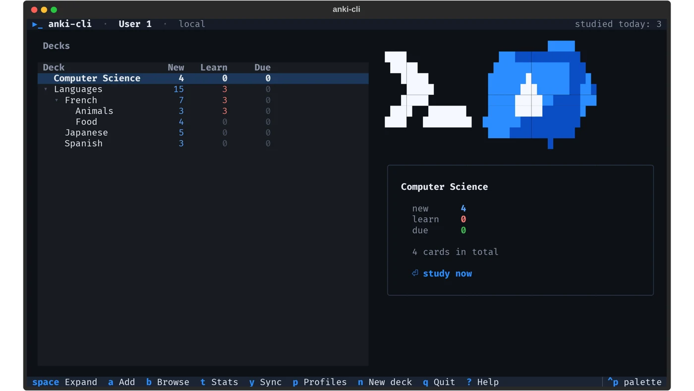
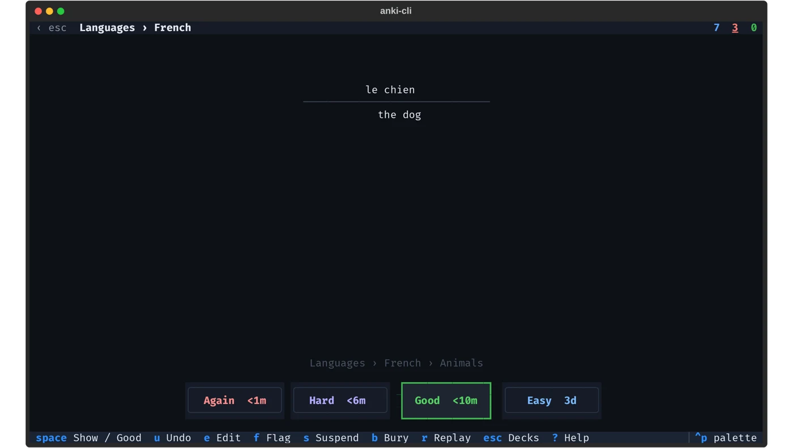
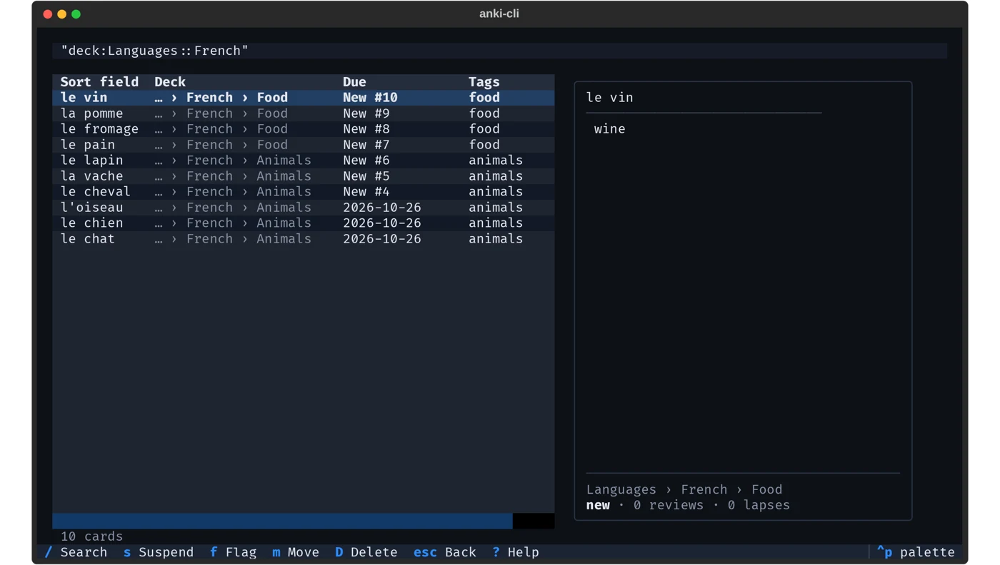
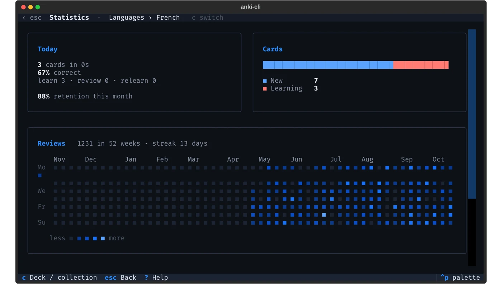

<p align="center">
  <picture>
    <source media="(prefers-color-scheme: dark)" srcset="docs/logo-dark.svg">
    
  </picture>
</p>

<h1 align="center">anki-cli</h1>

<p align="center">
  <b>Anki's own engine as a fast, headless server and command-line tool.</b><br>
  A drop-in replacement for <a href="https://ankiweb.net/shared/info/2055492159">AnkiConnect</a> that doesn't need
  Anki Desktop, a display, or a container running a GUI.
</p>

<p align="center">
  <a href="https://github.com/Macro002/anki-cli/actions/workflows/ci.yml"></a>
  
  
  
</p>

```bash
pip install git+https://github.com/Macro002/anki-cli
anki-cli serve                      # AnkiConnect-compatible API on http://127.0.0.1:8765
```

Anki is a Rust core with Python bindings, published by the Anki project as the
[`anki`](https://pypi.org/project/anki/) package — the same engine Anki Desktop runs.
anki-cli puts that engine behind the AnkiConnect protocols and a CLI, so your
collection, scheduler (FSRS and SM-2), card templates, media and AnkiWeb sync work
exactly as in Anki, at a fraction of the cost of running the desktop app.

## Why

AnkiConnect is an add-on: every request goes through a running Anki Desktop window.
On a server that means a virtual display, Qt and the full desktop app per
collection, and GUI-thread round trips on every call. anki-cli calls the engine
directly:

| | AnkiConnect in Anki Desktop | anki-cli |
|---|---|---|
| Needs | Anki Desktop running (display/VNC on servers) | Python and the `anki` package |
| Memory | the whole desktop app per collection | ~65 MB for the server with a collection open |
| A review step (current card, show answer, answer) | 3–4 calls through the GUI thread | ~4 ms total over HTTP |
| Collections per process | one (the open profile) | many, served in parallel |
| Sync, backups, FSRS, filtered decks over the API | partly / via GUI | yes ([61 extension methods](docs/methods.md#anki-cli-extensions--61-methods)) |

## What's included

* **Every AnkiConnect legacy action (122)**, with the same parameters, coercion rules,
  results and historical error strings — `addNote`, `cardsInfo`, `multi`, `guiDeckReview`,
  `storeMediaFile` … Existing clients (Yomitan, Obsidian_to_Anki, asbplayer,
  GameSentenceMiner, Jiten, LunaTranslator …) work unchanged.
* **The AnkiConnect v1 JSON-RPC API (95 methods)** at `/api/v1`, with typed records,
  pagination cursors, state tokens, batches and structured errors.
* **61 extensions**: AnkiWeb or self-hosted **sync** (login, full sync with an explicit
  side), **backups and restore** (`.colpkg`), **deck tree with due counts** in one call,
  **filtered decks and Custom Study**, **FSRS optimizer and simulator**, card info,
  bury/reposition, **CSV import/export**, empty cards, media check, undo/redo, config and
  preferences, profiles, a headless **reviewer** and browser. See [docs/methods.md](docs/methods.md).
* **A CLI** for humans and scripts: `decks`, `add`, `find`, `show`, `study` (in the
  terminal, with Anki's scheduler), `import`, `export`, `sync`, `backup`, `stats`,
  `check`, `profiles`, and `call` for any API method.
* **A full-screen terminal app** (`anki-cli tui`): deck tree, reviewer with audio,
  browser, note editor, statistics, sync and profiles. Works locally or against a server,
  including over SSH.
* **A Python client** (`ankicli.client.Client`) with keep-alive connections.

## Install

```bash
pip install git+https://github.com/Macro002/anki-cli          # Python 3.10+
```

Linux (x86_64/arm64), macOS and Windows are supported wherever the `anki` wheel is.

**Docker**

```bash
docker build -t anki-cli .
docker run -d -p 127.0.0.1:8765:8765 -v anki-data:/data -e ANKICLI_API_KEY=change-me anki-cli
```

or `docker compose up -d` with the included [docker-compose.yml](docker-compose.yml).
A hardened systemd unit is in [contrib/anki-cli.service](contrib/anki-cli.service).

## Quick start

```bash
anki-cli serve                                   # foreground; Ctrl-C closes collections cleanly
```

Legacy (AnkiConnect) protocol:

```bash
curl -s localhost:8765 -d '{"action":"addNote","version":6,"params":{"note":{
  "deckName":"Default","modelName":"Basic","fields":{"Front":"le chat","Back":"the cat"}}}}'
# {"result": 1793043556528, "error": null}
```

v1 JSON-RPC:

```bash
curl -s localhost:8765/api/v1 -d '{"jsonrpc":"2.0","id":1,"method":"decks.tree"}'
```

CLI:

```bash
anki-cli add --deck French Front="le chien" Back="the dog"
anki-cli decks
anki-cli find "deck:French is:due"
anki-cli study French                            # review in the terminal
anki-cli call notes.search query="tag:verb" limit=20
anki-cli call guiDeckReview name=French --legacy
```

When a server is running, the CLI talks to it automatically; otherwise it opens the
collection directly (`--url` and `--base` choose explicitly).

Python:

```python
from ankicli.client import Client

anki = Client("http://127.0.0.1:8765")
note = anki.call("notes.create", noteType={"name": "Basic"}, deck={"name": "French"},
                 fields={"Front": "la maison", "Back": "the house"})
state = anki.call("reviewer.start", deck={"name": "French"})
anki.legacy("findCards", query="deck:French")
```

## Terminal app

```bash
pip install "ankicli[tui] @ git+https://github.com/Macro002/anki-cli"
anki-cli tui                       # opens the collection, or connects to a running server
anki-cli tui --url http://server:8765 --key …
```

<p align="center">
  
  
  
  
</p>

* **Decks**: the tree with Anki's new / learning / due counts (daily limits applied);
  create, rename and delete decks.
* **Reviewer**: Anki's scheduler and its real interval labels. Press <kbd>space</kbd> to
  show the answer, <kbd>1</kbd>–<kbd>4</kbd> to rate, and <kbd>u</kbd> to undo. You can
  also edit, flag, suspend and bury from here. Card audio plays through `mpv`, `ffplay`,
  `afplay` or `paplay`.
* **Browser**: Anki search syntax, a sortable card table with flag and suspended colors,
  and a live preview. Suspend, flag, move, edit or delete without leaving it.
* **Editor**: adding uses a form for the note type with live duplicate warnings, and
  sticky fields are kept between notes.
* **Statistics**: today's numbers, card states, a year of reviews as a heatmap, and the
  due forecast, for one deck or the whole collection.
* **Sync and profiles**: log in to AnkiWeb or a self-hosted server and sync. When a full
  sync is needed you choose the side explicitly. You can also switch, create, rename and
  delete profiles.

Press <kbd>?</kbd> anywhere for every key. Cards are shown as text: formatting, cloze,
furigana (`猫(ねこ)`) and `[image: …]` placeholders. Styling from the deck's CSS is
not applied.

## Collections and profiles

anki-cli keeps profiles in a folder laid out like Anki Desktop's
(`<base>/<profile>/collection.anki2` + `collection.media/`), by default
`~/.local/share/anki-cli` (`--base` or `$ANKICLI_BASE` to change).

* **Use your existing Anki data:** `anki-cli serve --base ~/.local/share/Anki2`
  (macOS: `~/Library/Application Support/Anki2`, Windows: `%APPDATA%\Anki2`). Close Anki
  Desktop first — a collection can only be open in one program, and anki-cli says so
  clearly if it isn't.
* **A single file:** `--collection path/to/collection.anki2`.
* **Many collections in one server:** prefix any route with `/profiles/<name>/`
  (e.g. `POST /profiles/Alice/api/v1`) or send `X-Anki-Profile: Alice`. Each profile has
  its own worker thread, so collections are served in parallel. AnkiConnect's
  `getProfiles`/`loadProfile` and v1 `profiles.*` work on the active profile as usual.

## Anki's own pages

`anki-cli serve` also serves the screens Anki Desktop builds as web pages, so web apps
can show them unchanged: the **Statistics** screen, **Deck Options** (presets, every
option, FSRS optimize and simulate), **Card Info** and the congrats screen.

```
GET [/profiles/<name>]/pages/graphs[?deck=<deck id> | ?search=<search>]
GET [/profiles/<name>]/pages/deck-options/<deck id>
GET [/profiles/<name>]/pages/card-info/<card id>
GET [/profiles/<name>]/pages/congrats
```

Open one in a browser with `?key=<API key>` (it's exchanged for a cookie), or proxy it
with `Authorization: Bearer …` and announce the public path with `X-Forwarded-Prefix`.
The Statistics screen starts on `deck:current` like in Anki Desktop; `?deck=` selects that
deck first, `?search=` starts on any search (empty for the whole collection). Add
`?theme=dark` or `#night` for dark mode (otherwise the system setting). Embedded in
an iframe, a page reports `deckOptionsSaved` and `deckOptionsClose` to its parent with
`postMessage`.

The pages ship in Anki's GUI package (`aqt`), which needs Qt. anki-cli instead downloads
the `aqt` wheel matching your `anki` version from PyPI once, verifies its checksum and
keeps only the web files (about 5 MB, in `~/.cache/anki-cli/pages/`). Offline:
`anki-cli pages install --wheel aqt-<version>-py3-none-any.whl`.

## Sync

```bash
anki-cli sync login                      # AnkiWeb (or --endpoint https://your-sync-server/)
anki-cli sync                            # normal sync, media included
anki-cli sync --upload | --download      # when a full sync is required
```

Only Anki's session key is stored (in `anki-cli.json`, readable by the owner only),
never the password. A normal sync never resolves a full-sync conflict on its own: it
reports `fullSyncRequired` and you choose which side to keep. Over the API: `sync.login`,
`sync.run` (`mode: auto | upload | download`), `sync.status`; AnkiConnect's `sync`
action and v1 `collection.sync` use the stored login. Anki's self-hosted sync server
works too (`python -m anki.syncserver`).

## Security

* Listens on `127.0.0.1` by default. On other interfaces, set an API key:
  `anki-cli serve --host 0.0.0.0 --key …` (or `ANKICLI_API_KEY`). Legacy requests send it
  as `"key"`, v1 requests as `Authorization: Bearer …`, media URLs as `?key=`.
* Browser origins follow AnkiConnect's rules: `http://localhost`, `127.0.0.1` and browser
  extensions are allowed by default; add more with `--cors https://example.com` (or `*`).
  There is no permission dialog: `requestPermission` grants allowed origins and denies others.
* Media is served from `GET /media/<file>` (Range requests supported) for showing
  cards in web apps; file names can't escape the media folder.

## Performance

`python bench/bench.py` — 5,000-note collection, HTTP keep-alive, 4 CPUs:

| Call | median | p95 |
|---|---:|---:|
| `version` (round trip) | 0.12 ms | 0.14 ms |
| `deckNames` | 0.16 ms | 0.20 ms |
| `getDeckStats` | 1.25 ms | 1.48 ms |
| `findCards` (5,000 matches) | 1.19 ms | 1.48 ms |
| `cardsInfo` (1 card) | 0.31 ms | 0.46 ms |
| `cardsInfo` (50 cards) | 4.90 ms | 5.64 ms |
| `addNote` | 3.19 ms | 3.97 ms |
| review step (`guiCurrentCard` + `guiShowAnswer` + `guiAnswerCard`) | 4.08 ms | 5.96 ms |
| `decks.tree` (v1) | 1.92 ms | 2.97 ms |

* 5,000 notes with `addNotes` (500 per call): 2.3 s
* 8 concurrent clients: ~850 requests/s
* Server memory with the collection open: ~65 MB

## Reliability

Every operation runs on the collection's own thread and commits before the reply
(Anki's WAL-mode SQLite). The test suite checks what matters for a server that holds
people's study history:

* **Compatibility:** `tests/compat/run.py` runs **AnkiConnect's own test suite** —
  the recorded Yomitan, Obsidian_to_Anki, asbplayer, GameSentenceMiner, Jiten and
  LunaTranslator request flows, the legacy error baseline captured from the original
  implementation (every action at versions 2, 4 and 6) and its normalization rules — plus
  a v1 contract test that validates every result against AnkiConnect's JSON schema:
  **877 passed**, 15 desktop-only cases excluded ([details](tests/compat/README.md)).
* **Crash safety:** the server is `kill -9`ed mid-write by four writers; every
  acknowledged note is there afterwards and SQLite's integrity check passes.
* **Concurrency:** 32 clients add, read and search at once (nothing lost or duplicated);
  two collections are served in parallel.
* **Sync:** full upload, full download, incremental sync both ways, media and conflict
  handling against Anki's official sync server.
* **Clean shutdown, locked collections, size limits, CLI** and every extension.

```bash
pip install -e ".[test]"
pytest                          # 63 tests, offline
python tests/compat/run.py      # AnkiConnect's suite (fetches it at a pinned commit)
```

## Compared with other tools

| | anki-cli | [AnkiConnect](https://ankiweb.net/shared/info/2055492159) | [ubermenchh/anki-cli](https://github.com/ubermenchh/anki-cli) | [anki-connect-server](https://github.com/formeo14/anki-connect-server) |
|---|---|---|---|---|
| Engine | official `anki` package | Anki Desktop | own SQLite access + `fsrs` library, or AnkiConnect | official `anki` package |
| Runs without Anki Desktop | yes | no | direct mode only | yes |
| AnkiConnect legacy API | all 122 actions | — (reference) | client of it | 49 actions documented |
| AnkiConnect v1 API | all 95 methods | — (reference) | no | no |
| Checked against AnkiConnect's test suite | yes, 877 passed | — | no | no |
| AnkiWeb / self-hosted sync | yes, incl. full-sync choice | via GUI | no | yes |
| Many collections per process | yes | no | no | no |
| CLI | yes | no | yes (rich, with a TUI) | server and media tools |
| Terminal app (TUI) | yes: reviewer, browser, editor, stats, sync | no | yes | no |

Because anki-cli runs Anki's own engine, scheduling (FSRS and SM-2, learning steps,
daily limits, burying), template rendering and sync are Anki's — not a
reimplementation that can drift from it. Tools that write the database with their own
code have to keep up with every Anki release by hand.

## Differences from AnkiConnect

anki-cli has no windows, so the GUI actions work on headless equivalents:

* `guiDeckReview`, `guiCurrentCard`, `guiShowAnswer`, `guiAnswerCard`, `guiUndo` and the
  v1 `reviewer.*` methods drive a real reviewer session per collection: the head of Anki's
  v3 queue, answered with the scheduler's own states (daily limits, learning steps and
  burying behave exactly as in Anki). `guiPlayAudio`/`reviewer.playAudio` are no-ops —
  use `cards.answerAudio` and play the files yourself.
* `guiBrowse`/`guiSelectCard`/`guiSelectedNotes` keep a browser selection;
  `guiAddCards`/`guiAddNoteSetData`/`guiEditNote` keep editor drafts, which
  `editors.save` turns into notes.
* `guiImportFile` needs a path; `guiExitAnki`/`application.exit` stop the server only
  with `--allow-exit`.
* v1 *operations* finish before the reply; `operations.get` returns their result at once.
* `scheduling.answer` and `answerCards` work on any card, not only the head of the
  study queue (in Anki's backend they otherwise fail with "not at top of queue").

## Development

```bash
git clone https://github.com/Macro002/anki-cli && cd anki-cli
python -m venv .venv && .venv/bin/pip install -e ".[test]"
.venv/bin/pytest
python tools/gen_methods_doc.py        # regenerate docs/methods.md
```

Layout: `src/ankicli/services/` (one native implementation per method), `legacy.py`
(AnkiConnect legacy protocol), `rpc.py` (JSON-RPC v1), `server.py` (HTTP), `host.py`
(one thread per open collection), `profiles.py`, `cli.py`, `client.py`.

## License

[AGPL-3.0-or-later](LICENSE), because anki-cli builds on Anki's code, which is AGPL.
anki-cli is an independent project, not affiliated with Anki or AnkiConnect.
AnkiConnect (by Alex Yatskov and contributors) defines the protocols anki-cli
implements; its test suite is used for compatibility testing.
